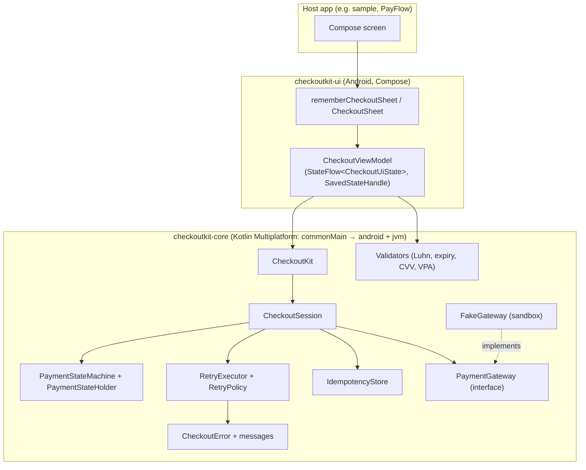
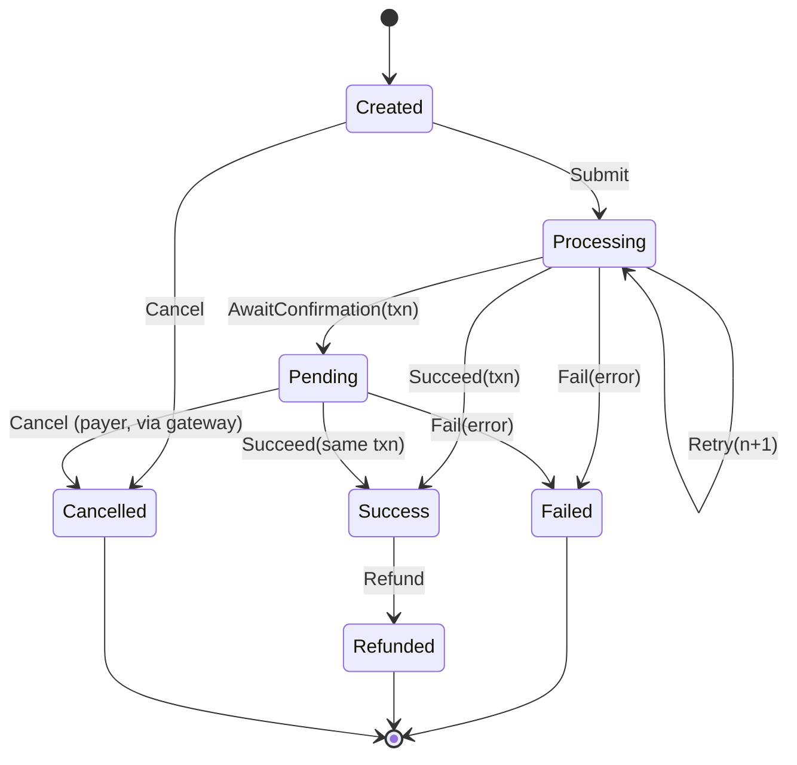

# CheckoutKit

**A drop-in Android payment SDK with a Kotlin Multiplatform core.** CheckoutKit gives an Android app
a Compose payment sheet (UPI, card, wallet) backed by a payment state machine that can't be pushed
into an illegal state. It retries safely with idempotency keys, reports typed errors, and plugs into
any payment gateway through one interface.

> **Sandbox only.** CheckoutKit ships with `FakeGateway`, an in-memory sandbox PSP. No real money
> moves and no network calls are made unless you plug in your own `PaymentGateway`. Card handling is
> for demonstration: a production integration must tokenise cards through a PCI-DSS compliant provider.

## Features

- **Payment state machine**: `Created → Processing → Pending → Success / Failed / Refunded / Cancelled`. It is a pure transition function tested exhaustively (all 49 state/event pairs), applied with compare-and-set so racing events can't corrupt a payment.
- **Retry and timeouts**: a configurable `RetryPolicy` with exponential backoff and jitter, per-attempt and total timeouts, `Retry-After` support, and cancellation safety (virtual-time tested).
- **Idempotency**: one key per checkout attempt, sent with every retry. Duplicate submits (double taps, 1,000 concurrent calls) share one charge and return the same result; reusing a key for a different amount is rejected.
- **Reconciliation**: a timeout never becomes "failed" while the money may have been captured. The SDK looks the payment up by key first and reports `Unresolved` if the gateway can't be reached.
- **Typed errors**: a sealed `CheckoutError` (network, timeout, declined, insufficient funds, invalid VPA, card expired, limit, authentication, rate limited, gateway, …), each with a stable code, a retryable flag and a user-facing message. Raw NPCI UPI and ISO 8583 card codes are mapped for you.
- **Pluggable gateway**: `PaymentGateway` (charge, status, refund), plus `FakeGateway` with configurable latency, spikes, outcomes, pending polls, refunds and magic test inputs.
- **Compose payment sheet**: `rememberCheckoutSheet(...)` with UPI, card and wallet tabs. It validates VPA format, Luhn and card brand, expiry (IST) and CVV length, masks the CVV and groups the card number. It survives rotation and process death, sets `FLAG_SECURE` and filters obscured touches.
- **Sample app** that demonstrates every outcome, including refunds.

## Screenshots

_Placeholder. Screenshots will be added from a real device:_

| Payment form | Processing | Pending (UPI collect) | Success | Declined |
|---|---|---|---|---|
| _todo_ | _todo_ | _todo_ | _todo_ | _todo_ |

## Tech stack

Kotlin 2.4.21 · Kotlin Multiplatform (Android + JVM targets) · kotlinx-coroutines 1.11 · Jetpack Compose (BOM 2026.09.00) · Material 3 · AndroidX Lifecycle ViewModel + SavedStateHandle · AGP 9.5 (built-in Kotlin) · Gradle 9.6 · JUnit 4 / kotlin.test · Turbine · Truth · Robolectric 4.17 · Kover · binary-compatibility-validator · JitPack.

minSdk 26, compileSdk/targetSdk 37, JDK 17 toolchain.

## Architecture



### Payment state machine



Every other move (for example a refund before success, a confirmation for a different transaction,
or anything after a terminal state) is rejected and leaves the state untouched.

## Installation

CheckoutKit is published on JitPack. Add the repository:

```kotlin
// settings.gradle.kts
dependencyResolutionManagement {
    repositories {
        google()
        mavenCentral()
        maven("https://jitpack.io")
    }
}
```

Then the dependency (the UI artifact brings the core with it):

```kotlin
// app/build.gradle.kts
dependencies {
    implementation("com.github.Darshan-05032003.CheckoutKit:checkoutkit-ui:v1.0.0")
    // Core only (no Compose), e.g. for a JVM module or your own UI:
    // implementation("com.github.Darshan-05032003.CheckoutKit:checkoutkit-core:v1.0.0")
}
```

## Quick start

```kotlin
// 1. Create the SDK once (Application, DI graph, or a remembered singleton).
val gateway = FakeGateway()                      // or your own PaymentGateway
val checkoutKit = CheckoutKit(gateway)

// 2. In a composable:
@Composable
fun CheckoutScreen(checkoutKit: CheckoutKit) {
    val sheet = rememberCheckoutSheet(checkoutKit, CheckoutSheetOptions(merchantName = "My Store")) { result ->
        when (result) {
            is CheckoutResult.Success -> { /* fulfil the order: result.transactionId */ }
            is CheckoutResult.Pending -> { /* waiting for the payer; check later */ }
            is CheckoutResult.Unresolved -> { /* unknown outcome: don't let them pay again yet */ }
            is CheckoutResult.Failed -> { /* result.error.code, result.error.toUserMessage() */ }
            CheckoutResult.Cancelled -> { /* payer closed the sheet */ }
            else -> Unit
        }
    }
    Button(onClick = { sheet.launch(CheckoutRequest(orderId = "order-42", amountPaise = 49_900)) }) {
        Text("Pay ₹499")
    }
    CheckoutSheet(sheet)
}
```

Without the UI (any Kotlin/JVM code):

```kotlin
val session = checkoutKit.createSession(CheckoutRequest("order-42", amountPaise = 49_900))
val result = session.submit(PaymentMethod.Upi("alice@okbank"))   // idempotent, retried, verified
session.state.collect { println(it.name) }                        // CREATED → PROCESSING → SUCCESS
```

Amounts are always `Long` paise (₹499.00 = `49_900`). Format them with `Money.formatInr(paise)`.

## API reference

| API | What it does |
|---|---|
| `CheckoutKit(gateway, config = CheckoutConfig())` | SDK entry point; owns the idempotency store. |
| `CheckoutKit.createSession(request, idempotencyKey = generate())` | Starts a checkout attempt (pass a saved key to retry the same attempt). |
| `CheckoutKit.resumeSession(request, idempotencyKey)` | Re-opens an attempt that may already be in flight (after process death); reconcile with `checkStatus()`. |
| `CheckoutKit.refund(transactionId, amountPaise, refundKey)` | Idempotent full refund by transaction id. |
| `CheckoutSession.submit(method): CheckoutResult` | Pays; idempotent, retried, polled while pending, verified, reconciled. |
| `CheckoutSession.checkStatus()` / `refund()` / `cancel()` | Resolve pending/unresolved, refund this payment, cancel before submitting. |
| `CheckoutSession.state: StateFlow<PaymentState>` / `history` | Live state and timestamped transitions. |
| `CheckoutRequest(orderId, amountPaise, currency = "INR", description)` | What to charge (validated: 1 paisa to ₹1 crore). |
| `PaymentMethod.Upi(vpa)` / `Card(number, expiryMonth, expiryYear, cvv)` / `Wallet(provider)` | How to pay (`Card.toString()` is masked). |
| `CheckoutResult` | `Success`, `Pending`, `Failed(error)`, `Unresolved(lastError)`, `Cancelled`, `Refunded`, `Rejected(error)`. |
| `PaymentState`, `PaymentEvent`, `PaymentStateMachine.transition(state, event)` | The state machine (pure, usable on its own). |
| `CheckoutError` (+ `code`, `retryable`), `toUserMessage()`, `CheckoutMessages`, `GatewayErrorCodes.fromCode(code, httpStatus, retryAfterMillis)` | Typed errors, payer-facing text, raw code mapping. |
| `RetryPolicy(maxAttempts, initialDelay, maxDelay, multiplier, jitterFactor, attemptTimeout, totalTimeout)`, `PendingPolicy(...)`, `CheckoutConfig(...)` | Retry/backoff/timeouts, pending polling, dispatcher, clock, randomness, idempotency TTL/size. |
| `PaymentGateway` (`charge`, `status`, `refund`), `GatewayResult`, `RefundResult`, `GatewayException` | The plug-in interface and its contract. |
| `FakeGateway(FakeGatewayConfig(outcome, latency, latencyJitter, latencySpikeChance, latencySpike, pendingPolls, transientFailures, magicInputs))`, `FakeOutcome` | Sandbox PSP. |
| `CardValidator`, `CvvValidator`, `ExpiryValidator`, `VpaValidator`, `Money` | Input validation and money formatting. |
| `rememberCheckoutSheet(checkoutKit, options, onResult): CheckoutSheetState`, `CheckoutSheet(state)`, `CheckoutSheetState.launch(request)` / `dismiss()` | The Compose sheet. |
| `CheckoutSheetOptions(methods, merchantName, secureWindow)`, `PaymentMethodOption`, `CheckoutSheetTestTags` | Sheet options and test tags for host UI tests. |

All public declarations carry KDoc. The public API is locked with Kotlin explicit API mode and the
binary-compatibility validator (`api/` dumps).

### FakeGateway magic inputs

| Input | Outcome |
|---|---|
| Card `4242 4242 4242 4242` | success |
| Card `4000 0000 0000 0002` | declined |
| Card `4000 0000 0000 9995` | insufficient funds |
| Card `4000 0000 0000 0069` | expired card |
| UPI `decline@…`, `broke@…`, `unknown@…` | declined, insufficient funds, invalid VPA |

## How to run

```bash
git clone https://github.com/Darshan-05032003/CheckoutKit.git && cd CheckoutKit
./gradlew :sample:installDebug          # sample app (needs a device or emulator)
./gradlew :sample:assembleRelease       # R8-minified, unsigned release APK
```

No `local.properties` keys are needed (only the usual `sdk.dir`). The sample has no network
permission: everything runs against `FakeGateway`.

The sample lets you pick an outcome (success, pending → success, network retry, declined,
insufficient funds, invalid UPI ID, timeout, gateway error, payer cancels, success then refund),
then pay through the real sheet and see the result.

## Tests

```bash
./gradlew allTests testDebugUnitTest      # unit + integration (core on JVM and Android host, UI and sample on Robolectric)
./gradlew stressTest                      # load/stress simulations (excluded from the normal run)
./gradlew :checkoutkit-core:koverLogJvm   # core line coverage (verification rule: ≥ 80 %)
./gradlew assembleDebug lintDebug         # the rest of the pre-commit gate
```

| Suite | Count |
|---|---|
| Unit (core commonTest + jvmTest, UI view model/transformations, sample) | 210 |
| Integration (core `integration` package; Robolectric Compose flows for sheet and sample) | 45 |
| Stress (`stress` packages, `./gradlew stressTest`) | 19 |

Core line coverage (Kover): **97.5 %**. UI module: **95.3 %**. The core's commonTest suite runs
twice, on the JVM and on the Android host target. See `docs/` for per-feature details.

## Security highlights

Full review: [`docs/SECURITY_REVIEW.md`](docs/SECURITY_REVIEW.md).

- Never reports "failed" for money that may have been captured: unknown outcomes are reconciled by idempotency key, and `Unresolved` is reported if the gateway is unreachable (found by the load test, fixed with regression tests).
- Every gateway answer is verified: a different amount, a different transaction id or a malformed id becomes `ResponseMismatch`, never `Success`.
- Idempotency keys are UUID v4 from a secure source. A key reused with a different request is rejected (replay protection), and duplicate submits share one charge.
- Card data: masked `toString()`, never written to saved state, wiped after each attempt. CVV is a password field, and the sheet window has `FLAG_SECURE`. `filterTouchesWhenObscured` blocks tapjacking.
- Hostile input is rejected or sanitised: unicode/RTL/homoglyph VPAs, Arabic-Indic digits, 100 KB pastes, log-injection gateway codes, absurd `Retry-After`. Amounts are bounded, `Long` paise only.
- The SDK writes no logs. Wrong UPI PINs and other auth failures are never retried automatically.

## Load-test highlights

Full report: [`docs/LOAD_TEST_REPORT.md`](docs/LOAD_TEST_REPORT.md). From `./gradlew stressTest` on a 15 GB laptop, JVM capped at 1 GB:

- **10,000 concurrent sessions** through the state machine in ~80 ms (~0.8 KB per session).
- **The same idempotency key fired 1,000x concurrently → exactly 1 charge**, for one session and for 1,000 restored sessions.
- **Retry storm**: 10,000 sessions against a gateway failing 50 % of attempts finish in ~0.6 s, never exceeding `maxAttempts` per key.
- **Thundering herd**: full jitter cut the peak retries in one 10 ms window from 10,000 to 106.
- **Latency-spike sweep** (8 s response spikes vs 3 s timeout): success ≥ 98 % up to 50 % spikes and **0 "failed but captured"** at every spike rate (2 to 20 of 2,000 before the reconciliation fix).
- 5,000 pending UPI payments polled concurrently: exactly 4 status calls each, all resolved.

## Project docs

- [`docs/PLAN.md`](docs/PLAN.md): build plan, modules, test plan, stress scenarios
- [`docs/DECISIONS.md`](docs/DECISIONS.md): design decisions and compromises
- [`docs/SECURITY_REVIEW.md`](docs/SECURITY_REVIEW.md): per-feature attacks, findings and fixes
- [`docs/LOAD_TEST_REPORT.md`](docs/LOAD_TEST_REPORT.md): per-feature load scenarios and numbers

## License

Portfolio project by Darshan Sonawane. All rights reserved unless a license file says otherwise.
