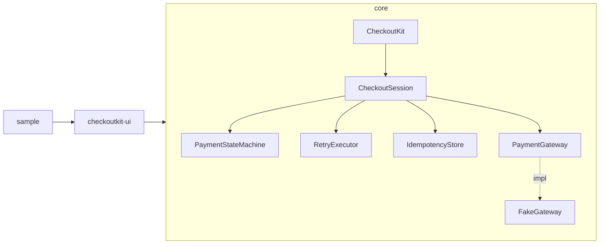

# CheckoutKit build plan

CheckoutKit is an Android payment SDK with a Kotlin Multiplatform core. The core holds all payment
logic (state machine, retry and timeout policy, idempotency, typed errors, gateway contract, input
validators). A Compose module renders a drop-in payment sheet bound to that core. A sample app shows
every outcome against a fake gateway. The SDK is published on JitPack.

## Modules and packages

| Module | Type | Packages |
|---|---|---|
| `checkoutkit-core` | KMP library (`commonMain`, `android`, `jvm`) | `com.darshan.checkoutkit.core` (facade, session, request/result), `.state` (state machine), `.retry` (policy, backoff, executor), `.idempotency`, `.error`, `.gateway` (+ `FakeGateway`), `.validation`, `.time` (clock), `.money` |
| `checkoutkit-ui` | Android library, Compose + Material 3 | `com.darshan.checkoutkit.ui` (public sheet API), `.internal` (view model, forms, visual transformations, error-to-string mapping) |
| `sample` | Android app | `com.darshan.checkoutkit.sample` (outcome picker → `FakeGateway` config → sheet) |

## Architecture rules
- Money is `Long` paise everywhere; formatting happens only at the edge (`Money.formatInr`).
- Time comes from an injectable `CheckoutClock`; coroutine dispatchers come from `CheckoutConfig`.
- The state machine is a pure function `(state, event) -> TransitionResult`. The session holds the
  current state in a `MutableStateFlow` and moves it only through compare-and-set, so concurrent
  callers can't corrupt it.
- Explicit API mode in both library modules; the binary-compatibility validator locks the API at 1.0.0.
- The UI exposes one `StateFlow<CheckoutUiState>` from an internal view model; card data never goes
  into saved state.

## Features in order (one commit each)
1. **Payment state machine**: `PaymentState` (Created, Processing, Pending, Success, Failed,
   Refunded, Cancelled), `PaymentEvent`, `PaymentStateMachine`, `TransitionResult`, `PaymentStateHolder`
   (CAS, transition history with clock timestamps).
   Tests: exhaustive 7 states x 7 events table, guards (txn id match, attempt monotonic), history,
   concurrent CAS.
2. **Retry/timeout + idempotency**: `RetryPolicy` (max attempts, exponential backoff, jitter,
   max delay, per-attempt timeout, total timeout), `Backoff`, `RetryExecutor` (cancellation-safe,
   virtual-time tested), `IdempotencyKey`, `IdempotencyStore` + `InMemoryIdempotencyStore`
   (single-flight, TTL, bounded size), `CheckoutSession`, `CheckoutKit` facade.
   Tests: delay math, jitter bounds, retry counts, cancellation propagation, timeouts with `runTest`,
   duplicate submits returning the same result, concurrent same-key single execution.
3. **Typed error codes**: sealed `CheckoutError` (Network, Timeout, Declined, InsufficientFunds,
   InvalidVpa, InvalidCard, CardExpired, LimitExceeded, AuthenticationFailed, RateLimited,
   GatewayError, InvalidRequest, ResponseMismatch, Unknown), retryability, `GatewayErrorCodes`
   (NPCI-style code mapping), `UserMessage` mapping.
   Tests: every subtype's code/retryable/message, unknown-code fallback, no PII in messages.
4. **Pluggable gateway + FakeGateway**: `PaymentGateway` (charge, status, refund), `ChargeRequest`,
   `GatewayResult`, `FakeGateway` (latency, spikes, outcomes, pending polls, server-side
   idempotency, refunds), status polling and refunds in the session, amount/txn verification.
   Tests: every fake outcome end to end through the session.
5. **Compose payment sheet**: validators in core (`CardValidator` Luhn + brand, `ExpiryValidator`,
   `CvvValidator`, `VpaValidator`), `rememberCheckoutSheet(...)`, `CheckoutSheet(...)`, UPI/Card/Wallet
   tabs, CVV masking, card-number grouping, states bound to the session, `FLAG_SECURE`, touch filtering.
   Tests: validator units, view model units, Robolectric Compose flows with `FakeGateway`.
6. **Sample app + docs**: outcome picker for success, pending→success, declined, insufficient
   funds, invalid VPA, timeout, gateway error, cancel, refund. README (pitch, install, quick start,
   API reference, Mermaid state diagram, tests, security, load), KDoc on all public API, R8 release.
7. **JitPack publish v1.0.0 + API lock**: `maven-publish` for core (KMP publications) and ui
   (release AAR), `jitpack.yml` (openjdk17), `apiDump` committed and `apiCheck` passing, tag and
   verify the JitPack build, verify consumption from a throwaway project.

## Test plan
- **Unit** (`commonTest`, run on JVM and Android host): state machine, policy math, executor,
  idempotency store, errors, validators, money, clock math, fake gateway.
- **Integration** (`commonTest/.../integration`, `checkoutkit-ui` Robolectric): session + fake
  gateway + idempotency store wired together; Compose sheet flow bound to the real session.
- **Stress** (`jvmTest/.../stress`, excluded from `allTests`, run with `./gradlew stressTest`).
- Coverage: Kover on `checkoutkit-core`, target ≥ 80 % lines.
- Gate before each commit: `./gradlew allTests testDebugUnitTest assembleDebug lintDebug`.

## Stress scenarios per feature
| Feature | Scenario |
|---|---|
| 1 | 10,000 concurrent sessions driven through the state machine on `Dispatchers.Default`; 1,000 coroutines racing one holder (exactly one winner per transition) |
| 2 | Retry storm: 10,000 sessions against a gateway failing 50 % with timeouts; same idempotency key fired 1,000x concurrently → exactly 1 charge; jitter spread (no thundering herd) |
| 3 | 1,000,000 gateway codes mapped (throughput, no allocation blow-up) |
| 4 | 10,000 sessions against `FakeGateway` with latency spikes and random outcomes; pending polling storm |
| 5 | 100,000 random card/VPA inputs through validators (incl. huge and unicode); view model under 1,000 rapid submits |
| 6 | Sample outcome matrix run 100x each through the session |
| 7 | Published artifact consumed by a fresh Gradle project |
